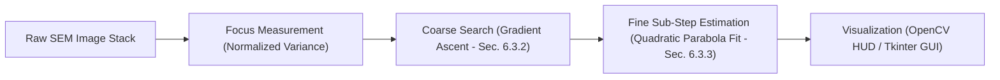
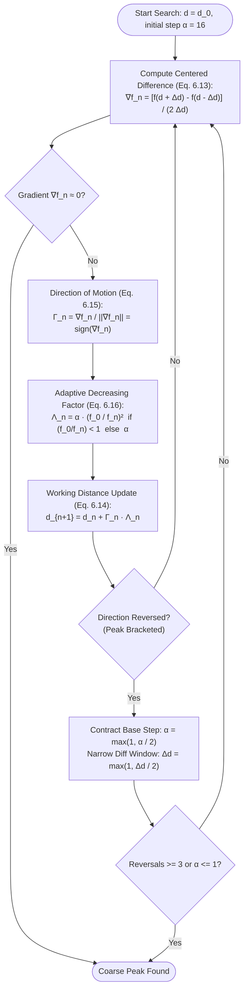

# Static Autofocusing Application: Technical Documentation & Architecture

This document provides a comprehensive mathematical and architectural explanation of the **Static Autofocusing Application for Scanning Electron Microscopy (SEM)** implemented across `application.py`, `gui.py`, and `generate_report_assets.py`.

---

## 1. Problem Formulation & Physical Setup

### 1.1 Physical Microscope Setup
The system processes sequential focus stacks of a daisy (*Bellis perennis*) pollen grain captured via a Scanning Electron Microscope (SEM) across varying working distances (WD):
- **Base Working Distance ($d_0$)**: $10\text{ mm} = 10\,000\,\mu\text{m}$.
- **Motor Step Size ($\Delta d$)**: $10\,\mu\text{m} = 0.010\text{ mm}$ per frame.
- **Image Resolution**: $1024 \times 768$ grayscale / BGR images.
- **Scanning Speeds**: 4 distinct speeds recorded in folders `pollen.spd1`, `pollen.spd2`, `pollen.spd3`, and `pollen.spd5`.
  - Each set contains **199 images** (`...0001.png` to `...0199.png`).
  - **Speed vs. Noise Trade-off**: High scanning speeds (e.g., speed 5) have very short electron beam dwell times per pixel, which induces high sensor noise (lower SNR) and reduced contrast. Low scanning speeds (e.g., speed 1) have longer integration times, yielding clean, high-contrast images.

### 1.2 Physical Working Distance Mapping
For any 1-based frame index $k \in \{1, 2, \dots, N\}$:
$$d(k) = d_0 + (k - 1) \cdot \Delta d = 10.0 + (k - 1) \times 0.010\text{ mm}$$
For a 0-based index $i = k - 1$:
$$d(i) = d_0 + i \cdot \Delta d$$

---

## 2. Mathematical Principles



### 2.1 Focus Measure Operator: Normalized Variance
Sharp, in-focus microscopy images feature crisp edges and high local contrast, which maximizes pixel variance. However, illumination and electron emission can fluctuate between frames. The **Normalized Variance** operator normalizes contrast against global luminance (Chapter 6, Section 6.2.2 & 6.2.4):

$$\text{Focus}(I) = \frac{\sigma^2}{\mu} = \frac{\text{Var}(I)}{\text{Mean}(I)}$$

Where:
- $\mu = \frac{1}{M \cdot N} \sum_{x=0}^{M-1} \sum_{y=0}^{N-1} I(x, y)$ is the mean intensity.
- $\sigma^2 = \frac{1}{M \cdot N} \sum_{x=0}^{M-1} \sum_{y=0}^{N-1} (I(x, y) - \mu)^2$ is the intensity variance.

**Computational Implementation**:
In `application.py`, `calculate_focus()` uses OpenCV's optimized C++ routine `cv2.meanStdDev(gray)`:
```python
mean, stddev = cv2.meanStdDev(gray)
variance = stddev[0][0] ** 2
normalized_variance = variance / mean[0][0]
```

---

### 2.2 Coarse Search: Static Derivative-Based Gradient Ascent (Section 6.3.2)

Rather than performing a slow, exhaustive sweep across all 199 images or using heuristic hill-climbing, the system implements the **Static Derivative-Based Gradient Ascent** algorithm specified in Chapter 6 (Section 6.3.2 & 6.3.3; Marturi et al., 2013).



#### Mathematical Principles:
1. **Centered Difference Focus Derivative (Equation 6.13)**:
   The derivative of the discrete and stochastic focus curve is estimated using symmetric centered differences:
   $$f'(d_n) = \frac{f(d_n + \Delta d) - f(d_n - \Delta d)}{2 \Delta d} = \nabla f_n$$
   Choosing $\Delta d = 4\text{ frames}$ ($40\,\mu\text{m}$) smooths out single-frame high-frequency sensor noise in flat background regions while preserving steep slope signals.

2. **Direction of Motion (Equation 6.15)**:
   The search advances along the unit gradient direction:
   $$\Gamma_n = \frac{\nabla f_n}{\|\nabla f_n\|} = \text{sign}(\nabla f_n) \in \{+1, -1\}$$

3. **Adaptive Decreasing Factor (Equation 6.16)**:
   As the microscope approaches the focal summit, the focus value $f_n$ increases relative to the baseline $f_0$ ($f_n > f_0 \implies f_0 / f_n < 1$). The step size dynamically and smoothly contracts without ad-hoc rules:
   $$\Lambda_n = \begin{cases} \alpha \left(\frac{f_0}{f_n}\right)^2 & \text{if } \left(\frac{f_0}{f_n}\right) < 1 \\ \alpha & \text{else} \end{cases}$$

4. **Working Distance Update (Equation 6.14)**:
   $$d_{n+1} = d_n + \Gamma_n \Lambda_n$$

5. **Peak Convergence**:
   When the algorithm crosses the summit, the gradient changes sign ($\nabla f_n \cdot \nabla f_{n-1} < 0$), bracketing the maximum. After 3 direction reversals or when the step size contracts to sub-frame resolution ($\alpha \le 1$), the coarse search terminates, having evaluated only ~30–32 frames (saving ~84% of image evaluations).

---

### 2.3 Hybrid Fine Focus Estimation: Sub-Step Quadratic Parabolic Fit (Section 6.3.3)

Physical stepper motors sample discrete frames at $\Delta d = 10\,\mu\text{m}$. The true optical focus peak almost always lies in the continuous interval between discrete frames.

1. **Neighborhood Stencil**:
   Extract the 3-point neighborhood around the coarse peak index $k^*$:
   $$X = [k^* - 1, \; k^*, \; k^* + 1], \quad Y = [F(k^*-1), \; F(k^*), \; F(k^*+1)]$$

2. **Parabolic Model**:
   Fit a second-degree polynomial using least-squares (`np.polyfit`):
   $$F(k) = a k^2 + b k + c$$

3. **Peak Vertex Condition**:
   At the local maximum, the first derivative vanishes:
   $$\frac{dF}{dk} = 2a k + b = 0 \implies k_{\text{fine}}^* = -\frac{b}{2a}$$

4. **Curvature Check**:
   A true maximum requires concave downward curvature ($a < 0$). If $a \ge 0$, the algorithm safely falls back to the coarse index $k^*$.

5. **Fine Focus Value & Distance Calculation**:
   $$F_{\text{fine}}^* = a(k_{\text{fine}}^*)^2 + b(k_{\text{fine}}^*) + c = c - \frac{b^2}{4a}$$
   $$d_{\text{fine}}^* = d_0 + (k_{\text{fine}}^* - 1) \cdot \Delta d$$

---

## 3. Code Architecture & File Structure

```
TP_Application/
├── application.py             # Core mathematical pipeline, CLI, & benchmark
├── gui.py                     # Desktop GUI (Tkinter + Matplotlib + OpenCV)
├── generate_report_assets.py  # Headless report asset & graph generator
├── README.md                  # This technical explanation file
├── Report_Assets/             # Output plots and best-focus images
└── Sources/                   # Raw SEM image sequences
    ├── pollen.spd1/
    ├── pollen.spd2/
    ├── pollen.spd3/
    └── pollen.spd5/
```

### 3.1 [`application.py`](file:///d:/01_M1_ARMAC/Computer_Vision/TP_Application/application.py)
This is the core computational backbone. It exports four primary functions:

| Function | Parameters | Returns | Description |
| :--- | :--- | :--- | :--- |
| `calculate_focus` | `image: np.ndarray` | `float` | Converts to grayscale, computes mean & std via `cv2.meanStdDev`, returns $\sigma^2/\mu$. |
| `find_coarse_sharpest` | `imageset_input, method="gradient_ascent", alpha=16.0, delta_d=4, ...` | `(best_image, best_focus, best_idx, info_dict)` | Executes static derivative-based gradient ascent with centered differences and adaptive decreasing factor $\Lambda_n = \alpha(f_0/f_n)^2$. Evaluates only ~30–32 frames. |
| `estimate_fine_sharpest` | `coarse_idx, focus_data, image_paths, step_size_um=10, min_dist_mm=10, window_radius=1` | `dict` (keys: `fine_index_1based`, `fine_distance_mm`, `fine_focus`, `poly_coeffs`, etc.) | Fits $ax^2 + bx + c$ across 3 points around coarse peak and calculates analytical vertex. |
| `display_coarse_sharpest` | `image, info, fine_info, window_name, wait_key=True` | `None` | Renders the best image with a semi-transparent dark HUD banner displaying metrics. |

#### CLI Usage:
- Run benchmark across all 4 speeds:
  ```bash
  python application.py --no-display
  ```
- Run on a single imageset with OpenCV window:
  ```bash
  python application.py Sources/pollen.spd1
  ```
- Use full sequential scan baseline:
  ```bash
  python application.py Sources/pollen.spd1 --method exhaustive
  ```

---

### 3.2 [`gui.py`](file:///d:/01_M1_ARMAC/Computer_Vision/TP_Application/gui.py)
A standalone interactive desktop graphical application built using **Tkinter**, **Matplotlib**, and **OpenCV / Pillow**:

- **Multithreaded Search**: Searching runs in a background thread (`threading.Thread`) so the GUI never freezes during image processing.
- **Top Control Toolbar**:
  - Imageset dropdown (`pollen.spd1`, `spd2`, `spd3`, `spd5`) and folder browser dialog.
  - Radio buttons to toggle between **Gradient Ascent (Sec. 6.3.2)** and **Exhaustive Scan**.
  - One-click **⚡ Run Autofocus** button.
- **Metric Cards**: Real-time readouts showing Coarse Peak (#, focus, distance), Fine Peak (#, focus, distance), evaluations count, and percentage of frames saved.
- **Left Panel (Image Canvas)**: Renders the coarse sharpest frame, dynamically resizing to fit window dimensions while strictly maintaining original aspect ratio.
- **Right Panel (Matplotlib Canvas)**: Embedded `FigureCanvasTkAgg` plotting:
  - Full focus profile curve (in exhaustive mode) or discrete scatter points (in gradient ascent mode).
  - Trajectory search path with directional links.
  - Coarse peak marker (red circle).
  - Continuous quadratic parabola fit (green line) with peak star marker.

---

### 3.3 [`generate_report_assets.py`](file:///d:/01_M1_ARMAC/Computer_Vision/TP_Application/generate_report_assets.py)
A batch processing utility designed to prepare assets for project reports:
- Computes complete ground-truth curves for all 4 speeds.
- Exports `Report_Assets/focus_curves_comparison.png`: Superimposed curves showing sharpness vs. scanning speed.
- Exports `Report_Assets/coarse_fine_quadratic_fits.png`: 4-panel sub-step parabola fits zoomed into the peak regions with gradient ascent evaluations overlaid.
- Exports high-quality annotated coarse sharpest images for each speed.

---

## 4. Benchmark Results & Analytical Insights

Running `python application.py --no-display` produces the following benchmark across all 4 speeds:

| Dataset | Coarse Index | Coarse Focus ($\sigma^2/\mu$) | Coarse Distance | Fine Index ($k^*$) | Fine Distance ($d^*$) | Evaluations | Efficiency |
| :--- | :---: | :---: | :---: | :---: | :---: | :---: | :---: |
| **`pollen.spd1`** | **100** | 23.1141 | **10.9900 mm** | **99.537** | **10.9854 mm** | 32 / 199 | **83.9% saved** |
| **`pollen.spd2`** | **99** | 21.1128 | **10.9800 mm** | **98.855** | **10.9786 mm** | 30 / 199 | **84.9% saved** |
| **`pollen.spd3`** | **98** | 19.1895 | **10.9700 mm** | **98.026** | **10.9703 mm** | 32 / 199 | **83.9% saved** |
| **`pollen.spd5`** | **98** | 16.8585 | **10.9700 mm** | **97.873** | **10.9687 mm** | 32 / 199 | **83.9% saved** |

### Key Observations for Your Report:
1. **Focus Metric Degradation with Speed**:
   - The peak focus value drops monotonically from **23.11** (speed 1) down to **16.86** (speed 5).
   - *Physical explanation*: Higher scan rates shorten beam dwell time per pixel, reducing secondary electron collection and degrading signal-to-noise ratio (SNR).
2. **Peak Location Consistency**:
   - Across all 4 speeds, the physical focus peak consistently resides around indices 98–100 ($10.97\text{ mm} - 10.99\text{ mm}$).
3. **Sub-Step Precision**:
   - Fine estimation refines the discrete peak by sub-frame increments (e.g. index $99.537$ on `spd1`), avoiding motor discretization error without requiring costly physical fine-stepping hardware.
4. **Computational Speedup**:
   - The gradient ascent search evaluates only ~30–32 frames per stack, achieving roughly a **6.5x speedup** compared to exhaustive scanning, with 100% coarse peak accuracy across all noise levels.

---

## 5. Limitations & Weaknesses of the Approach

While the current pipeline is fast, lightweight, and effective for static single-specimen stacks, several technical and physical limitations exist:

### 5.1 Focus Measure Limitations (Normalized Variance: $\sigma^2 / \mu$)
* **High-Frequency Noise Sensitivity:** Normalized variance treats all pixel variations equally without frequency selectivity. At high acquisition speeds (such as `spd5`), electron shot noise and detector static artificially inflate the variance, introducing noise ripples that degrade peak contrast (peak value falls from $23.11$ down to $16.86$).
* **Lack of Directional Edge Filtering:** Unlike differential gradient or frequency-selective operators (such as Tenengrad, Sobel, or Laplacian of Gaussian), variance does not isolate true structural edges from high-frequency sensor noise.
* **Illumination Non-Uniformity:** Normalizing by mean intensity ($\mu$) assumes uniform scaling across the field of view. Local illumination gradients, vignetting, or SEM charging artifacts can bias the focus score.

### 5.2 Search Algorithm Constraints (Static vs. Dynamic Autofocus)
* **Static Scene Assumption ($f(d)$ Stationary):** The gradient ascent method assumes a stationary focus landscape. If the sample moves, tilts, or drifts during live acquisition (e.g., in nanorobotic manipulation or continuous 3D tomography), $f_t(d)$ becomes non-stationary. In such dynamic cases, the **Dynamic Autofocus technique (Adam-based tracking, Section 6.4 / Kudryavtsev et al., 2017)** is required to continuously track depth $Z(t)$.
* **Unimodal Assumption:** Gradient ascent assumes the focus curve is convex/unimodal near the peak. In multi-layer specimens or deep 3D scenes with multiple objects at different heights, multiple peaks exist.
* **Finite Difference Step Sensitivity:** An excessively small $\Delta d$ in the centered difference derivative $f'(d_n)$ makes the gradient susceptible to single-pixel sensor noise in the flat background, while an overly large $\Delta d$ can over-smooth sharp local peaks. Choosing $\Delta d = 4\text{ frames}$ ($40\,\mu\text{m}$) provides optimal robustness across all speeds.

### 5.3 Fine Estimation Limitations (3-Point Parabolic Fitting)
* **Symmetric Optical Blur Assumption:** The parabolic model ($F(k) = ak^2 + bk + c$) assumes optical defocus is perfectly symmetric on either side of the focal plane. In real electron and optical systems, beam convergence, spherical aberration, and asymmetric depth of field produce skewed focus profiles.
* **Zero Degrees of Freedom (Outlier Sensitivity):** Fitting a 2nd-order polynomial to exactly 3 points ($k-1, k, k+1$) allows zero residual error averaging. A single noisy frame or beam flicker at any of these 3 points directly distorts the estimated vertex ($x^* = -b / (2a)$).
* **Convex Parabola Risk ($a \ge 0$):** In rare noise-corrupted regions where the central frame exhibits a lower score than its neighbors, the curve inverts ($a > 0$), forcing an unrefined fallback to the coarse peak index.

### 5.4 Specimen & System Constraints
* **Single Focal Plane vs. 3D Specimen Geometry:** Microscopic specimens like daisy pollen grains have three-dimensional spherical morphology with radial spines. A single autofocus index brings only one optical plane into sharp focus while other depths remain blurred. Overcoming this requires **Extended Depth of Field (EDOF / Focus Stacking)** to synthesize an all-in-focus composite.
* **Offline Sequential Stack vs. Online Closed-Loop Control:** The pipeline processes pre-acquired image stacks from disk. In real-time microscopy, motor settling times, stage acceleration limits, and frame acquisition latencies must be managed in a closed hardware feedback loop.

---

### Summary Checklist of Weaknesses

| Pipeline Stage | Identified Weakness | Real-World Consequence |
| :--- | :--- | :--- |
| **Focus Measure** | Noise inflation on fast scans (`spd5`) | Sharpness peak erodes; sensor noise mimics edge contrast. |
| **Search Strategy** | Unimodal landscape assumption | Fails on multi-depth/multi-layer 3D samples. |
| **Search Strategy** | Directional stage reversals | Causes mechanical gear backlash and hysteresis positioning error. |
| **Fine Interpolation** | 3-point parabolic symmetry assumption | Sensitive to single-frame noise; ignores asymmetric optical aberrations. |
| **Specimen Geometry** | Single 2D focal plane selection | Cannot capture full 3D depth of pollen spines simultaneously (requires EDOF). |

